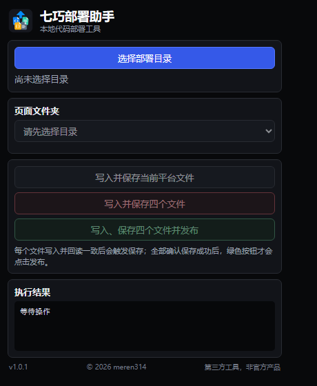

<div align="center">
  
  <h1>七巧部署助手</h1>
  <p>面向道一云七巧自定义页面的 Chrome 快捷部署工具</p>

  <p>
    
    
    
    
  </p>

  <p>
    <a href="#功能亮点">功能亮点</a> ·
    <a href="#安装方法">安装方法</a> ·
    <a href="#使用方法">使用方法</a> ·
    <a href="#安全机制">安全机制</a> ·
    <a href="#许可说明">许可说明</a>
  </p>
</div>

---

## 项目简介

在道一云七巧开发自定义页面时，通常需要分别打开四个代码编辑区，逐个复制本地文件、保存并发布。重复操作耗时，也容易出现文件切换错误、内容写入错误或忘记保存等问题。

七巧部署助手将本地页面目录中的四个标准文件自动匹配到平台编辑区，提供写入、内容校验、保存确认和按需发布的一体化流程。

本扩展在浏览器本地运行，不包含将项目代码上传至版权所有者服务器的功能。

## 界面预览

<div align="center">
  
</div>

## 功能亮点

| 功能 | 说明 |
| --- | --- |
| 四文件自动映射 | 自动匹配 HTML、CSS、JavaScript 和服务端自定义函数 |
| 批量写入 | 一次完成四个文件的切换和内容写入 |
| 写入后校验 | 回读编辑器内容，确认与本地文件完全一致 |
| 自动保存 | 每个文件写入后触发保存，并等待平台保存成功反馈 |
| 按需发布 | 只有四个文件全部校验并保存成功后才执行发布 |
| 重复运行保护 | 已打开多个编辑标签时仍会核对当前目标文件，降低串写风险 |
| 本地目录记忆 | 自动记住上次选择的目录和页面文件夹 |
| 多编辑器适配 | 支持 Ace、Monaco、CodeMirror 5 和普通 `textarea` |

## 文件映射

每个可部署页面文件夹应包含以下四个标准文件：

| 本地文件 | 道一云七巧编辑区 | 用途 |
| --- | --- | --- |
| `index.html` | `index.html` | 页面结构 |
| `index.css` | `index.css` | 页面样式 |
| `index.js` | `index.js` | 前端逻辑 |
| `server.js` | `自定义函数` | 服务端函数 |

推荐目录结构：

```text
七巧部署/
├─ 物料库存管理/
│  ├─ index.html
│  ├─ index.css
│  ├─ index.js
│  └─ server.js
└─ 采购入库管理/
   ├─ index.html
   ├─ index.css
   ├─ index.js
   └─ server.js
```

选择部署根目录后，扩展扫描其一级子文件夹。只有四个标准文件齐全的文件夹才会显示在页面列表中；额外文件不会影响识别，也不会被写入平台。

## 安装方法

Chrome 不能直接安装本项目提供的 ZIP 文件，必须先完整解压。

1. 下载并解压项目文件。
2. 在 Chrome 地址栏打开 `chrome://extensions/`。
3. 打开页面右上角的“开发者模式”。
4. 点击“加载已解压的扩展程序”。
5. 选择直接包含 `manifest.json` 的 `七巧部署助手-chrome` 文件夹。
6. 在 Chrome 扩展程序菜单中固定“七巧部署助手”。

如果出现 `Could not unzip extension for install`，说明 Chrome 正在尝试直接安装 ZIP。关闭提示、完整解压文件，然后重新选择包含 `manifest.json` 的文件夹即可。

## 使用方法

1. 登录道一云七巧，进入需要部署的自定义页面 IDE。
2. 展开左侧前端和后端文件树，确认能够看到三个前端文件和“自定义函数”。
3. 点击 Chrome 工具栏中的“七巧部署助手”。
4. 首次使用时选择部署根目录，后续会优先恢复上次选择。
5. 在“页面文件夹”中选择需要部署的页面。
6. 根据需要选择写入当前文件、写入全部四个文件或写入并发布。
7. 查看执行结果，确认每个文件均已写入并保存成功。
8. 在七巧预览或实际业务页面中核对本次版本。

### 操作按钮

| 按钮 | 作用 |
| --- | --- |
| 写入并保存当前平台文件 | 只处理七巧 IDE 当前活动标签对应的文件 |
| 写入并保存四个文件 | 依次写入、校验并保存四个文件，不执行发布 |
| 写入、保存四个文件并发布 | 四个文件全部写入、校验和保存成功后，点击平台发布按钮 |

## 本地状态保存

1. 扩展使用浏览器本地存储保存上次选择的目录句柄和页面文件夹名称。
2. 再次打开扩展时会尝试自动恢复目录和页面选择。
3. Chrome 重启后可能要求重新确认目录读取权限，此时点击“恢复上次目录”即可。
4. 更换根目录后，新的目录和页面选择会自动保存。

## 安全机制

1. 写入前先切换目标文件，并核对当前活动编辑标签。
2. 等待编辑器会话和内容稳定后再执行写入。
3. 写入后回读编辑器内容，要求与本地文件完全一致。
4. 每个文件都会单独触发保存，并等待本次保存成功反馈。
5. 任一文件切换、写入、校验或保存失败时，立即停止后续操作。
6. 只有绿色的发布按钮会在四个文件全部保存成功后执行发布。
7. 原编辑器内容会暂存在当前平台页面的 `sessionStorage` 中，用于当前会话内的安全保护。

## 兼容范围

当前版本包含以下编辑器适配器：

| 编辑器 | 支持状态 |
| --- | --- |
| Ace Editor | 已支持 |
| Monaco Editor | 已支持 |
| CodeMirror 5 | 已支持 |
| 普通 `textarea` | 已支持 |

不同租户或平台后续升级可能改变 IDE 页面结构。如果出现“未识别右侧代码编辑器”或“平台编辑标签未切换到目标文件”等提示，请停止发布并提交问题信息。

## 使用提醒

1. 部署前确认本地页面、平台应用和业务页面一致。
2. 重要版本发布前，建议先备份平台现有代码。
3. 首次部署建议使用“写入并保存四个文件”，检查无误后再发布。
4. 不要在无权访问或无权部署的应用中使用本工具。
5. 发现页面、标签或内容异常时立即停止，不要重复点击发布。

## 许可说明

版权所有 © 2026 meren314。保留所有权利。

本项目源码公开，采用自定义的源码可用许可协议：

1. 任何个人或组织均可免费安装和使用。
2. 允许为自身使用目的查看、备份和修改源代码。
3. 允许免费分享未经修改的原始版本，但必须保留版权声明和完整许可证。
4. 未经版权所有者书面许可，不得销售、转售、收费分发或重新打包销售本软件。
5. 修改版本不得冒充官方版本，也不得删除或替换版权标识。

完整条款请阅读 [LICENSE.txt](LICENSE.txt)。本许可不是 MIT、GPL、Apache 等标准开源许可证，对外请描述为“源码公开”或“Source Available”。

## 第三方声明

七巧部署助手是适用于道一云七巧开发场景的第三方辅助工具，并非道一云官方产品，也未声明获得道一云官方授权、认证或背书。“道一云”“七巧”、Google Chrome 以及其他产品名称和商标归各自权利人所有。

---

<div align="center">
  <strong>七巧部署助手 1.0.1</strong><br>
  <sub>Copyright © 2026 meren314</sub>
</div>
